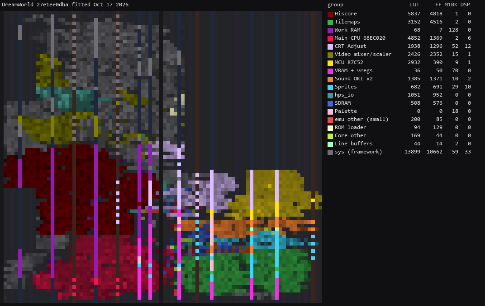
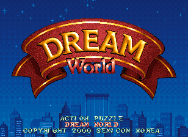
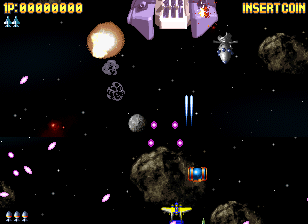
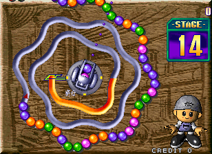
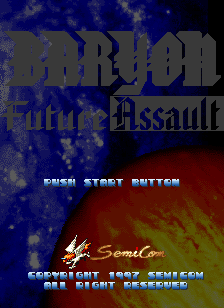

# SemiCom 68020 core for MiSTer

A MiSTer FPGA core for SemiCom's 68EC020 arcade hardware (MAME's `dreamwld.cpp`), built with
Quartus Prime 17.0.2 Lite for the DE10-nano.

**Status: all seven sets boot and play on a DE10-nano, with sound.**

## Contents

- [History](#history)
- [Games](#games)
  - [Supported](#supported)
  - [Not yet](#not-yet)
  - [Out of scope for now](#out-of-scope-for-now)
- [Hardware](#hardware)
  - [Video timing](#video-timing)
  - [Floorplan](#floorplan)
- [Screenshots](#screenshots)
- [Installation](#installation)
- [Controls](#controls)
- [Status](#status)
  - [Features](#features)
  - [Todo](#todo)
  - [Resource usage](#resource-usage)
- [AI Attestation](#ai-attestation)
- [Verification](#verification)
- [Acknowledgements](#acknowledgements)
- [Layout](#layout)
- [License](#license)

## History

- `Arcade-DreamWorld_20261017.rbf`: first release, built from `27e1ee0` (fitter seed default, every
  clock met, worst `clk_sys` setup slack +4.873 ns). All seven sets, with sound.

The core started as a copy of this author's Psikyo core, whose CPU, tilemap and sprite engines it
adapts.

## Games

The five SemiCom games MAME runs on this board, seven sets, one `.rbf`. Every set fits a 32 MB
SDRAM module (the image is 13.9 MB).

### Supported

Sets with an `.mra` in `releases/`. All seven boot, take a coin, start and pause on the release
build.

| Name | Year | Manufacturer | Orientation | Notes |
|-|-|-|-|-|
| Dream World | 2000 | SemiCom | horizontal | |
| Cute Fighter | 1998 | SemiCom | horizontal | |
| Baryon - Future Assault (set 1) | 1997 | SemiCom / Tirano | vertical | hiscore save |
| Baryon - Future Assault (set 2) | 1997 | SemiCom / Tirano | vertical | hiscore save |
| Rolling Crush (version 1.07.E) | 1999 | SemiCom / Exit (Trust license) | horizontal | hiscore save |
| Rolling Crush (version 1.03.E) | 1999 | SemiCom / Exit | horizontal | |
| Gaia - The Last Choice of Earth | 1999 | SemiCom / XESS | horizontal | |

Six of the seven protection MCU programs are reconstructions MAME marks `BAD_DUMP`; the core runs
the programs MAME ships.

### Not yet

None.

### Out of scope for now

None: `dreamwld.cpp` has no other sets.

## Hardware

| Chip | Function | Status |
|-|-|-|
| MC68EC020, 16 MHz | main CPU | TG68K.C (Tobias Gubener), vendored; boot traced against MAME |
| 87C52, 16 MHz | protection MCU | jt8052 (jotego's JT8051, via the Eolith core), vendored, running the set's own MCU program |
| OKI M6295 x2, 1 MHz | sound | jt6295 (jotego), vendored; command traces from MAME replayed against a transcription of MAME's chip |
| two tilemaps, sprites | video | adapted from the Psikyo core's per-line engines to `dreamwld.cpp`'s formats; checked against MAME frames |

### Video timing

6.75 MHz pixel clock (54 MHz / 8), 444 pixels a line, 263 lines: 15.203 kHz and 57.805 Hz, against
MAME's declared 57.793 Hz. 308 x 224 visible, as MAME's `set_visarea`. MAME gives no raw timing, so
the totals and sync positions are chosen (`docs/HACKS.md`).

### Floorplan

The release revision at `27e1ee0`, fitted Oct 17 2026 (`scripts/floorplan.py`; per-block counts in
`docs/floorplan/DreamWorld_groups.md`):

## Screenshots

From the core, native resolution.

| Dream World | Cute Fighter | Gaia | Rolling Crush |
|-|-|-|-|
|  |  |  |  |

Baryon (vertical): 

## Installation

A 32 MB SDRAM module is required.

* Take the latest `*.rbf` from `releases/` and put it in `_Arcade/cores`, renamed to drop the
  `Arcade-` prefix (`Arcade-DreamWorld_YYYYMMDD.rbf` becomes `DreamWorld_YYYYMMDD.rbf`). MiSTer launches
  the highest-sorting match for `<rbf>DreamWorld</rbf>`, and a `DreamWorld_*.rbf` sorts above every
  `Arcade-DreamWorld_*.rbf`
* Take the `*.mra` files and the `_alternatives` folder from `releases/` and put them in `_Arcade`
  (or a subdirectory starting with an underscore, e.g. `_Arcade/_DreamWorld`)
* Put the MAME merged or split ROM sets in `games/mame`

To run a development build instead: `python scripts/build_staged.py`, then `python scripts/deploy.py`
with a `mister.env` (see `scripts/deploy.py`).

## Controls

8-way joystick, Start, Coin and Pause per player; the buttons per game:

| Game | Button 1 | Button 2 | Button 3 |
|-|-|-|-|
| Dream World | Dig | Jump | Book |
| Cute Fighter | Attack | Strong Attack | Catch |
| Baryon | Shot | Bomb | - |
| Gaia | Shot | Bomb | - |
| Rolling Crush | Launch | - | - |

Dream World's names are the driver's, Cute Fighter's the game's own how-to-play screen. No manual
or flyer names the others' buttons; they are named for what each does (`scripts/build_mra.py`).

Keyboard, MAME's defaults: arrows / R F D G, buttons LCtrl LAlt Space / A S Q, Start 1 / 2,
Coin 5 / 6, P pause. Service mode is the DIP switch.

## Status

Known issues:
- The 68020 runs about half as fast as MAME's model in the protection handshake loop, so a game
  reaches its first frame about 0.8 s later than in MAME; after that the dreamwld attract keeps
  MAME's pace (`docs/ROADMAP.md`).
- Baryon's and Rolling Crush's attract demos play differently from MAME's: 25 s after launch the
  tilemaps and score display match a MAME frame, the ships, shots and balls do not. The cause is
  not known (`docs/ROADMAP.md`, Phase 5). Dream World's, Cute Fighter's and Gaia's match MAME
  pixel for pixel.
- Palette, tile VRAM and scroll are read as each line is drawn; MAME draws the whole frame at
  vblank. A palette fade step can colour the top lines of one frame in the previous step's colours
  (`docs/HACKS.md`).

`docs/MAME_KLUDGES.md` lists what is taken from MAME as behaviour and what is known not to be
right. `docs/HACKS.md` lists this core's own approximations. `docs/ROADMAP.md` is the plan and its
progress; `docs/LESSONS_LEARNED.md` is what it cost.

### Features

* DIP switches from the `.mra` (`DIP;` in the OSD): done
* Inputs: done, pads and MAME's keyboard keys
* CRT Adjust (H-Position, V-Shift, H-Size, V-Size): present, not yet checked at 308 columns
* HDMI scaling (integer scale, crop, crop offset): present (`video_freak`), not yet checked on a display
* HDMI rotation (orientation): done, Auto from the set (Baryon); checked from the rotated frame buffer
* Flip screen, HDMI and analog, from the OSD or the DIP (fake DIP, the board has none): done; the OSD option and the DIP together flip twice
* HDMI-only options hidden under direct video: done
* Peripheral menus shown only for games that use them: n/a
* Rotary joysticks (Ikari Warriors controls, GRS keystroke mode), where used: n/a
* Light guns: mouse, analog stick and synthetic crosshair, where used: n/a
* Audio mix (Mono, None, 25%, 50%): done
* Hiscore saving (`hiscore.v`, with autosave): Baryon (both sets) and Rolling Crush 1.07, from MAME's hiscore.dat; not yet exercised with a new score
* NVRAM / EEPROM saved to the `.nvm` file: n/a
* Fast ROM loading via DDR: done
* Pause (with CPU suspended): done
* Sound: done, both OKI M6295 with their bank registers
* Savestates (optional): not yet
* Cheats (optional): not yet

### Todo

- [ ] Check CRT Adjust, Scale and Crop on a display
- [ ] Exercise hiscore save and restore
- [ ] Find why Baryon's and Rolling Crush's attract demos differ from MAME's

### Resource usage

The release revision at `27e1ee0` (default seed) on the DE10-nano's Cyclone V 5CSEBA6, speed
grade 7, timing met on every clock (worst `clk_sys` setup slack +4.873 ns):

| resource | used | available |
| --- | --- | --- |
| Logic (ALMs) | 22,045 | 41,910 |
| Block memory bits | 2,905,580 | 5,662,720 |
| RAM blocks | 397 | 553 |
| DSP blocks | 65 | 112 |
| PLLs | 3 | 6 |

## AI Attestation

This core is being developed with heavy use of a frontier coding assistant.
<!-- The author's familiarity with the platform and games: to be written by the author. -->

## Verification

Not PCB-validated. MAME is the accuracy reference, with its own acknowledged uncertainties noted
where they matter.

* `.mra` images: all seven byte-for-byte equal to MAME's ROM_START (13,901,824 bytes each).
* CPU: dreamwld's first 50 ms of bus writes equal MAME's (34,223 of 34,223); the protection stream
  intact as far as the bench ran (1,586 of 1,737 bytes, none wrong); on hardware the handshake
  completes in dreamwld (1,737) and cutefght (1,793).
* Video model: `scripts/render_model.py` identical to MAME on 49 scenes, seven per set.
* Video RTL: `sim/frame_tb` identical to the model on 12 scenes from all seven sets, two frames
  each, and flipped on two scenes against the model turned 180.
* Hardware: 11 of 12 dreamwld attract screenshots identical to a MAME frame; the twelfth differs in
  rows 0-27 during a palette fade (known issue above). Three flipped screenshots, turned 180,
  identical to MAME frames.
* Sprites in play: the sprite engine's per-line overrun counter read zero on the board from coin-up
  through 3,195 frames of Dream World (`121f144`); `sim/frame_tb` with CPU traffic on the shared
  SDRAM port, identical to the model.
* Sound: `sim/oki_phrase_tb` 20 of 20 dreamwld phrases sample-identical to a transcription of
  MAME's `okim6295.cpp`; `sim/oki_trace_tb` replays 3 s of MAME's OKI writes from dreamwld play,
  identical for the first 12,065 samples, then voice starts up to one sample late
  (`docs/MAME_KLUDGES.md`). By ear on the board: Dream World and Baryon.
* Release build (`27e1ee0`): all seven sets boot, take a coin, start, and pause and resume
  (`scripts/play_test.py`). Attract screenshots 25 s after launch: Dream World, Cute Fighter and
  Gaia identical to MAME frames; Baryon and Rolling Crush differ in the demo (known issue above).

## Acknowledgements

- **Sorgelig** and the **MiSTer-devel team** for the
  [Template_MiSTer](https://github.com/MiSTer-devel/Template_MiSTer) framework, the SDRAM controller
  and the screen rotator.
- The **MAMEdev team** — David Haywood — for `dreamwld.cpp` and the device emulations that are this
  core's specification.
- **Tobias Gubener** for [TG68K.C](https://github.com/TobiFlex/TG68K.C) (LGPL-3.0).
- **Jose Tejada (jotego)** for [jt8051](https://github.com/jotego/jt8051) and
  [jt6295](https://github.com/jotego/jt6295) (GPL-3.0).
- **Alan Steremberg** and **Jim Gregory** for [Hiscores_MiSTer](https://github.com/JimmyStones/Hiscores_MiSTer).
- **rmonic79** for CRT Adjust.

## Layout

Standard [Template_MiSTer](https://github.com/MiSTer-devel/Template_MiSTer) structure:

| path | contents |
| - | - |
| `sys` | MiSTer framework, vendored from the template, never edited |
| `rtl` | core source; vendored modules carry a `PROVENANCE.md` |
| `releases` | `.rbf` and `.mra` files; clones in `_alternatives` |
| `docs` | roadmap, workflow, release process, kludges, hacks, lessons |
| `sim` | ModelSim and Verilator testbenches |
| `scripts` | build, deploy, capture and verification tooling |
| `debug` | reference captures from MAME used as ground truth (gitignored) |
| `roms` | your own MAME sets (gitignored, never committed) |

## License

GPL-3.0-or-later (see `LICENSE`). Imported components keep their own licences, listed in
`THIRD-PARTY.md` and stated in each `PROVENANCE.md`; every modified vendored file states the change
in its header.

Game ROMs contain copyrighted material and are not included. Obtaining them is your
responsibility.
